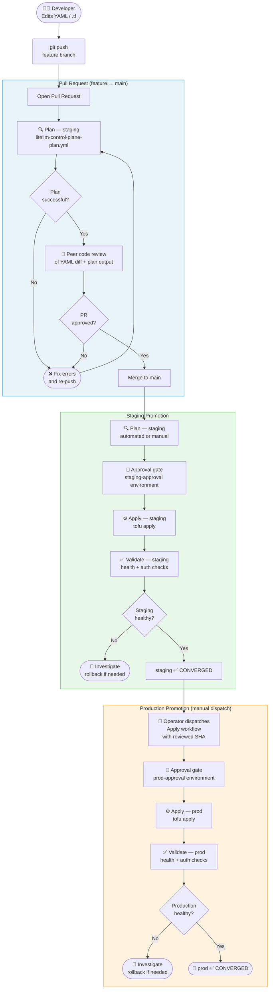
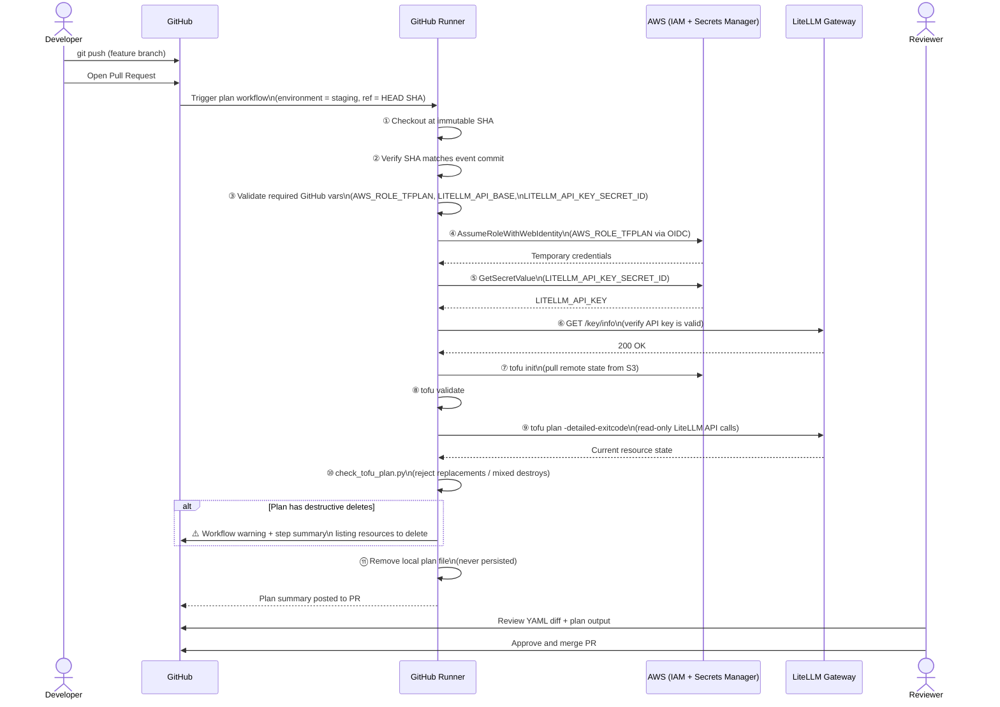
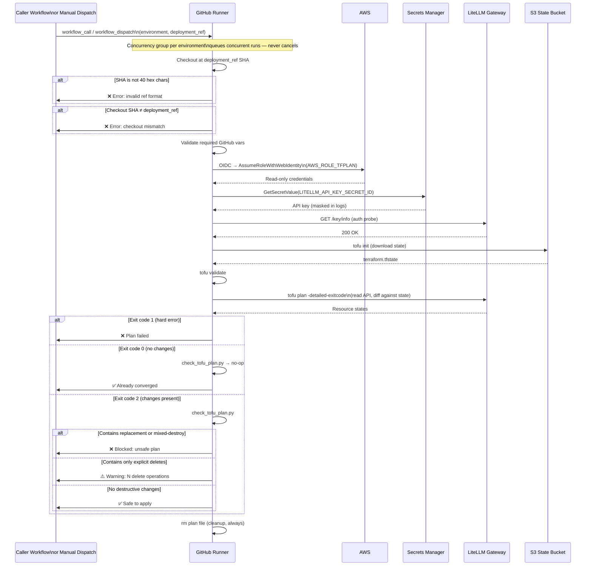
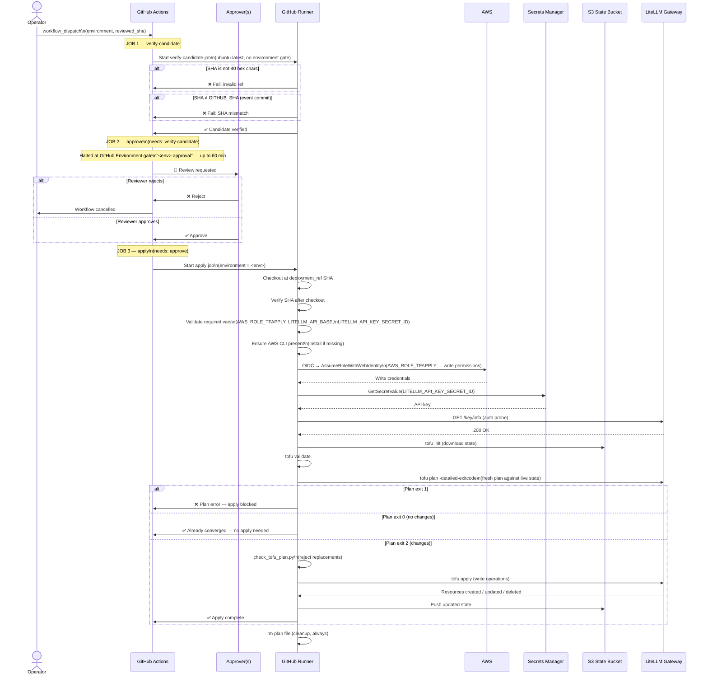
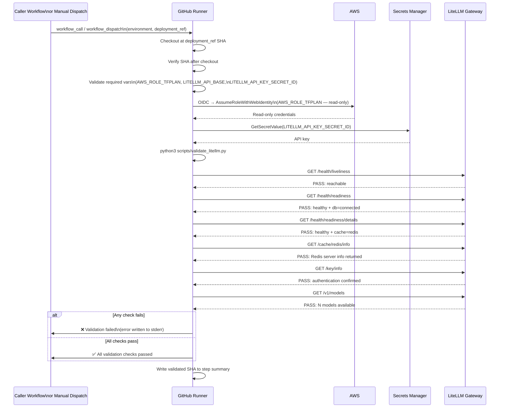

# CI/CD Workflow Reference

This document describes the three GitHub Actions workflows that implement the
GitOps control plane for LiteLLM. All three workflows are **reusable**
(`workflow_call`) and can also be triggered **manually** (`workflow_dispatch`).

---

## Contents

1. [End-to-End Promotion Path](#1-end-to-end-promotion-path)
2. [Pull Request Flow](#2-pull-request-flow)
3. [Plan Workflow](#3-plan-workflow-litellm-control-plane-planyml)
4. [Apply Workflow](#4-apply-workflow-litellm-control-plane-applyyml)
5. [Validation Workflow](#5-validation-workflow-litellm-control-plane-validateyml)
6. [Security Controls Summary](#6-security-controls-summary)

---

## 1. End-to-End Promotion Path

This diagram shows how a configuration change flows from a developer's branch
all the way through staging and into production.

> **Key principle — immutable candidates:** Every workflow that touches
> infrastructure pins to a full 40-character commit SHA. The SHA is verified
> twice — once before checkout and once after — to prevent TOCTOU substitution.

---

## 2. Pull Request Flow

When a PR is opened or updated, the plan workflow runs automatically (if wired
via a caller workflow) or can be triggered manually. Its sole purpose is to
make the diff visible and safe to review.

---

## 3. Plan Workflow (`litellm-control-plane-plan.yml`)

This reusable workflow can be called by a parent workflow or dispatched
manually. It is **read-only** — it never mutates LiteLLM state.

---

## 4. Apply Workflow (`litellm-control-plane-apply.yml`)

The apply workflow is the **only path that mutates LiteLLM state**. It is
structured as three sequential jobs — verification, approval, and apply — to
ensure no code runs against the gateway without a human sign-off.

---

## 5. Validation Workflow (`litellm-control-plane-validate.yml`)

Run after every apply to confirm the live gateway is healthy. Uses
`validate_litellm.py` which issues **read-only GET requests only** — it never
mutates state.

---

## 6. Security Controls Summary

| Control | Where enforced |
|---|---|
| **Immutable SHA pinning** | All three workflows verify the checkout SHA before and after `actions/checkout` |
| **Replacement blocked** | `check_tofu_plan.py` rejects any plan containing `create_before_destroy` or mixed destroy+create actions |
| **Destructive change visibility** | Explicit deletes emit a named GitHub workflow warning and are listed in the step summary |
| **Human approval gate** | Apply workflow pauses on the `<env>-approval` GitHub Environment; requires configured reviewers |
| **Least-privilege IAM** | Plan uses `AWS_ROLE_TFPLAN` (read-only); Apply uses `AWS_ROLE_TFAPPLY` (write) |
| **Credentials never in code** | API key fetched from Secrets Manager at runtime; never stored in YAML, HCL, or workflow files |
| **Concurrency lock** | All three workflows share a concurrency group per environment; concurrent runs queue, never cancel |
| **Production viewer-only users** | `users.tf` lifecycle precondition rejects any human user with a non-viewer role in the production environment |
